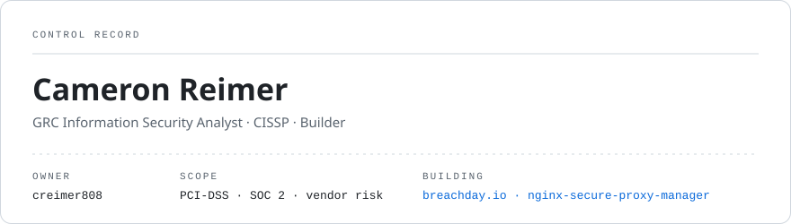

<picture>
  <source media="(prefers-color-scheme: dark)" srcset="assets/header-dark.svg">
  
</picture>

Security analyst who also ships software. By day I run PCI-DSS assessments, SOC 2 audits and vendor risk. The rest of the time I build tools that make security work less painful.

### now building

- **[breachday.io](https://breachday.io)**: tabletop exercises for security teams. Live injects and role-based play, joined with a room code.
- **[vigilus.dev](https://vigilus.dev)**: self-hosted AI ops. Agents work on real infrastructure using scoped, just-in-time tokens, and every action is audit-logged.

### open source

| | |
|:--|:--|
| [`nginx-secure-proxy-manager`](https://github.com/creimer808/nginx-secure-proxy-manager) | Nginx proxy hosts, managed from one interface |
| [`pi-stepwise`](https://github.com/creimer808/pi-stepwise) | a linear 4-command workflow for the Pi coding agent |
| [`freeipa-client-setup`](https://github.com/creimer808/freeipa-client-setup) | FreeIPA client enrollment in one script |
| [`wazuh-unifi-setup`](https://github.com/creimer808/wazuh-unifi-setup) | shipping UniFi logs into Wazuh |
| [`hdd-health`](https://github.com/creimer808/hdd-health) | S.M.A.R.T. drive reports sent to Discord |

### record

**CISSP** · B.S. Cyber Operations + B.S. Network & Security Administration, Dakota State 
CrowdStrike Fal.Con CTF 9th/53 · LogRhythm CTF 29th/105 · TryHackMe top 7% · CyberPatriot 3rd in state

**works with** CrowdStrike · Nessus · Tenable.SC · Qualys · NIST · ISO 27001 &nbsp;/&nbsp; **builds with** TypeScript · Python · Next.js · tRPC · Prisma · Postgres · Docker
